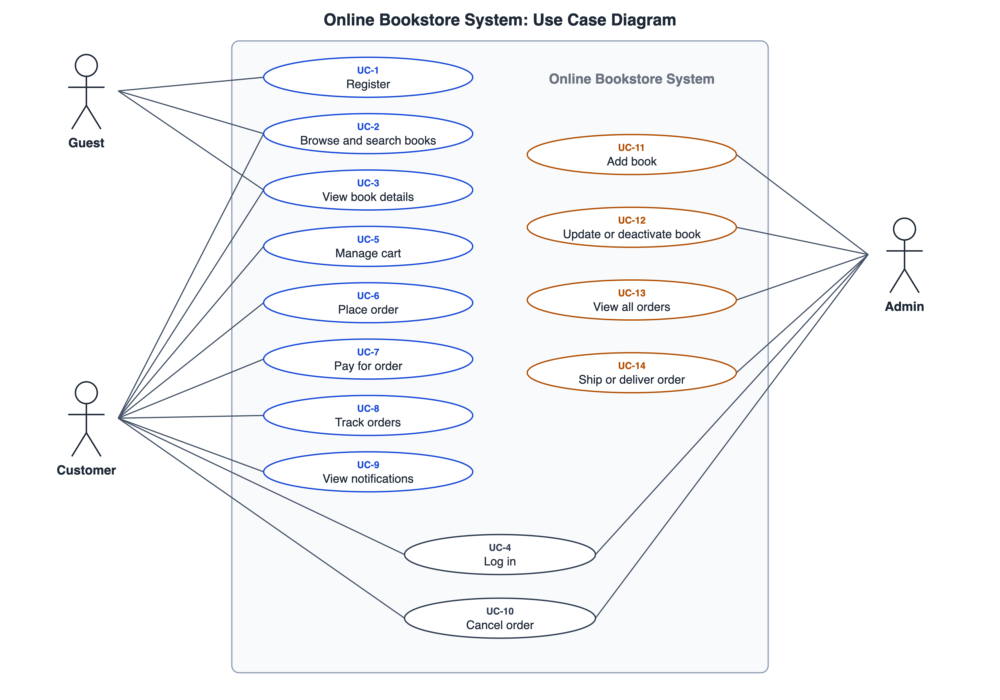

# Week 1: Requirements and Use Cases

## 1. Project scope

The Online Bookstore System lets people browse a book catalog, register and
log in, manage a shopping cart, place orders and pay using a simulated
payment. Administrators maintain the catalog and move orders through their
lifecycle.

**Technology:** Python + FastAPI, MySQL 8, simple HTML/JS frontend, Swagger UI
for API documentation.

### Out of scope

- Real payment processing. Payments are simulated and no card data is stored.
- Real email delivery. Email notifications are simulated by writing to the log.
- Shipping costs, tax, discount codes, multiple currencies (all prices are USD).
- Book reviews and recommendations.

## 2. Actors

| Actor | Description |
|---|---|
| Guest | Visitor who is not logged in. Can browse the catalog and register. |
| Customer | Registered user. Can use a cart, order, pay and track orders. |
| Admin | Staff user. Manages books and advances orders through their lifecycle. |

## 3. Functional requirements

### Catalog

| ID | Requirement |
|---|---|
| FR-1 | The system shall list active books with pagination. |
| FR-2 | The system shall search books by title, author or ISBN. |
| FR-3 | The system shall filter books by category. |
| FR-4 | The system shall show a book's details, including price and availability. |

### Accounts

| ID | Requirement |
|---|---|
| FR-5 | A guest shall be able to register a customer account with a unique email. |
| FR-6 | A registered user shall be able to log in and receive an access token (JWT). |
| FR-7 | A logged-in user shall be able to view their own profile. |
| FR-8 | The system shall restrict each endpoint according to the user's role. |

### Shopping cart

| ID | Requirement |
|---|---|
| FR-9 | A customer shall be able to add a book to their cart. |
| FR-10 | A customer shall be able to change the quantity of a cart item. |
| FR-11 | A customer shall be able to remove an item from the cart. |
| FR-12 | A customer shall be able to view the cart with line totals and a grand total. |
| FR-13 | The system shall reject a quantity greater than the available stock. |

### Orders and payment

| ID | Requirement |
|---|---|
| FR-14 | A customer shall be able to place an order from their cart. Placing an order shall, in one database transaction, create the order, record the current prices, reduce stock and empty the cart. |
| FR-15 | A customer shall be able to view their order history and each order's details. |
| FR-16 | A customer shall be able to cancel their order before it ships. Cancelling shall restore stock. |
| FR-17 | A customer shall be able to pay for a pending order by choosing credit card, PayPal or bank transfer (all simulated). |
| FR-18 | The system shall record every payment attempt. A failed attempt shall leave the order pending so the customer can retry. |

### Order lifecycle

| ID | Requirement |
|---|---|
| FR-19 | The system shall allow only the status changes shown in section 6 and reject all others. |
| FR-20 | The system shall record every status change, including who made it and when. |

### Notifications

| ID | Requirement |
|---|---|
| FR-21 | The system shall notify the customer when an order is placed, paid, shipped, delivered or cancelled. |
| FR-22 | A customer shall be able to view their notifications and mark them as read. |

### Administration

| ID | Requirement |
|---|---|
| FR-23 | An admin shall be able to add a book. |
| FR-24 | An admin shall be able to update a book's details, price and stock. |
| FR-25 | An admin shall be able to deactivate a book so it no longer appears for sale. |
| FR-26 | An admin shall be able to view all orders and mark them shipped or delivered. |

## 4. Non-functional requirements

| ID | Category | Requirement |
|---|---|---|
| NFR-1 | Security | Passwords shall be stored only as bcrypt hashes. |
| NFR-2 | Security | Protected endpoints shall require a valid JWT. |
| NFR-3 | Privacy | Card numbers and similar payment details shall never be stored. |
| NFR-4 | Data integrity | Money shall use exact decimal types. Orders shall be atomic and shall not oversell stock. |
| NFR-5 | Usability | All API endpoints shall be documented in Swagger UI. |
| NFR-6 | Maintainability | The code shall be separated into API, service, pattern and data layers, and shall apply at least 5 design patterns. |
| NFR-7 | Portability | The system shall run locally using documented setup steps. |

## 5. Use cases

| ID | Use case | Actors | Requirements | Built in |
|---|---|---|---|---|
| UC-1 | Register | Guest | FR-5 | Week 3 |
| UC-2 | Browse and search books | Guest, Customer | FR-1, FR-2, FR-3 | Week 4 |
| UC-3 | View book details | Guest, Customer | FR-4 | Week 4 |
| UC-4 | Log in | Customer, Admin | FR-6, FR-7, FR-8 | Week 3 |
| UC-5 | Manage cart | Customer | FR-9 to FR-13 | Week 4 |
| UC-6 | Place order | Customer | FR-14 | Week 5 |
| UC-7 | Pay for order | Customer | FR-17, FR-18 | Week 5 |
| UC-8 | Track orders | Customer | FR-15, FR-20 | Week 6 |
| UC-9 | View notifications | Customer | FR-21, FR-22 | Week 7 |
| UC-10 | Cancel order | Customer, Admin | FR-16, FR-19 | Week 6 |
| UC-11 | Add book | Admin | FR-23 | Week 4 |
| UC-12 | Update or deactivate book | Admin | FR-24, FR-25 | Week 4 |
| UC-13 | View all orders | Admin | FR-26 | Week 6 |
| UC-14 | Ship or deliver order | Admin | FR-19, FR-26 | Week 6 |

### UC-6: Place order

- **Actor:** Customer
- **Precondition:** The customer is logged in and the cart is not empty.
- **Main flow:**
  1. The customer enters a shipping address and confirms the order.
  2. The system starts a transaction and locks the books in the cart.
  3. The system confirms that every book is active and has enough stock.
  4. The system creates the order as `PENDING` and copies each book's current price.
  5. The system reduces stock and empties the cart.
  6. The system commits the transaction and notifies the customer.
- **Alternative flow:** If a book is unavailable or short of stock at step 3,
  the system rolls back, leaves the cart unchanged and reports which book
  caused the problem.
- **Postcondition:** A `PENDING` order exists and its stock is reserved.

### UC-7: Pay for order

- **Actor:** Customer
- **Precondition:** The customer owns an order in `PENDING` status.
- **Main flow:**
  1. The customer selects a payment method and submits the required details.
  2. The system selects the strategy for that payment method.
  3. The strategy simulates the charge and returns a transaction reference.
  4. The system records the successful payment.
  5. The order moves to `PAID` and the customer is notified.
- **Alternative flow:** If the simulated charge fails, the system records a
  `FAILED` payment, the order stays `PENDING` and the customer may retry.
- **Postcondition:** The order is `PAID` and has one successful payment.

### UC-14: Ship or deliver order

- **Actor:** Admin
- **Precondition:** The admin is logged in and the order is `PAID` or `SHIPPED`.
- **Main flow:**
  1. The admin chooses an order and the next action.
  2. The order's current state object validates the action.
  3. The system updates the status and records it in the history.
  4. The customer is notified.
- **Alternative flow:** If the action is not valid for the current state, such
  as delivering a `PENDING` order, the system rejects it and nothing changes.
- **Postcondition:** The order has advanced by one step.

## 6. Order lifecycle

| Current status | Event | New status | Who |
|---|---|---|---|
| `PENDING` | Payment succeeds | `PAID` | System |
| `PENDING` | Cancel | `CANCELLED` | Customer, Admin |
| `PAID` | Ship | `SHIPPED` | Admin |
| `PAID` | Cancel (simulated refund) | `CANCELLED` | Customer, Admin |
| `SHIPPED` | Deliver | `DELIVERED` | Admin |

`DELIVERED` and `CANCELLED` are final. Stock is restored whenever an order is
cancelled.

## 7. Design pattern plan

| Pattern | Purpose in this system | Requirements | Built in |
|---|---|---|---|
| Factory | `UserFactory` creates a `Customer` or `Admin` with the correct role and defaults. | FR-5, FR-8 | Week 3 |
| Singleton | One shared database connection manager and one configuration object. | NFR-6 | Week 3 |
| Strategy | One interchangeable payment class per method, chosen at checkout. | FR-17, FR-18 | Week 5 |
| State | One class per order status, each deciding which actions are valid. | FR-19, FR-20 | Week 6 |
| Observer | Order events are published to subscribed in-app and email notifiers. | FR-21 | Week 7 |
