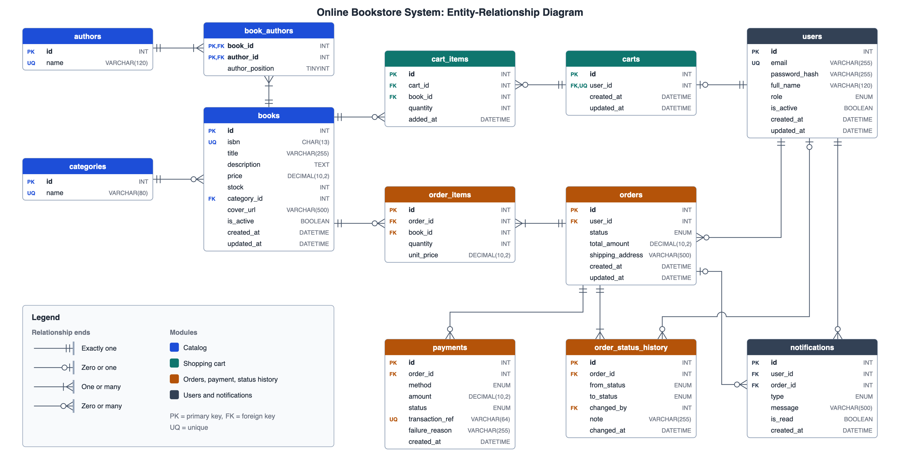

# Week 2: Database Design

**Database:** MySQL 8 (InnoDB, utf8mb4)
**Scripts:** [`db/schema.sql`](../db/schema.sql) and [`db/seed.sql`](../db/seed.sql)

## 1. Entity-relationship diagram

## 2. Tables

| Table | Purpose | Supports |
|---|---|---|
| `users` | Customers and admins, separated by `role` | Factory |
| `categories` | Book categories | Catalog |
| `authors` | Book authors | Catalog |
| `books` | Books for sale, with price and stock | Catalog |
| `book_authors` | Links books to their authors | Catalog |
| `carts` | One shopping cart per user | Cart |
| `cart_items` | Books in a cart and their quantities | Cart |
| `orders` | Placed orders and their current status | State |
| `order_items` | Books in an order, with the price paid | Orders |
| `payments` | Every payment attempt and its method | Strategy |
| `order_status_history` | Audit trail of status changes | State |
| `notifications` | In-app notifications | Observer |

The Singleton pattern applies to the application's database connection rather
than to a table.

## 3. Relationships

| Parent | Child | Cardinality | Enforced by |
|---|---|---|---|
| `users` | `carts` | 1 to 0..1 | `carts.user_id` (unique) |
| `carts` | `cart_items` | 1 to 0..N | `cart_items.cart_id` |
| `books` | `cart_items` | 1 to 0..N | `cart_items.book_id` |
| `categories` | `books` | 1 to 0..N | `books.category_id` |
| `books` | `authors` | N to M | `book_authors` junction table |
| `users` | `orders` | 1 to 0..N | `orders.user_id` |
| `orders` | `order_items` | 1 to 1..N | `order_items.order_id` |
| `books` | `order_items` | 1 to 0..N | `order_items.book_id` |
| `orders` | `payments` | 1 to 0..N | `payments.order_id` |
| `orders` | `order_status_history` | 1 to 1..N | `order_status_history.order_id` |
| `users` | `order_status_history` | 0..1 to 0..N | `order_status_history.changed_by` (nullable) |
| `users` | `notifications` | 1 to 0..N | `notifications.user_id` |
| `orders` | `notifications` | 0..1 to 0..N | `notifications.order_id` (nullable) |

## 4. Design decisions

| Decision | Reason |
|---|---|
| One `users` table with a `role` column | Customers and admins share the same fields. The Factory pattern handles their differences in code. |
| `order_items.unit_price` copies the price | Changing a book's price must not alter past orders. This is a deliberate snapshot of historical data, so it does not break normalization. |
| `orders.total_amount` is stored | It records the amount charged at purchase and is calculated once, inside the order transaction. |
| Books are deactivated, not deleted | `order_items` must keep pointing to the book. Foreign keys block deletion of a book that has been ordered. |
| `payments` allows many rows per order | A failed attempt followed by a successful retry should both be recorded (FR-18). |
| No card data in `payments` | Simulated payments need only the method and a generated reference (NFR-3). |
| `DECIMAL(10,2)` for money | Floating-point types cannot represent every cents value exactly. |
| `stock` cannot go below zero | The `CHECK` constraint is a final safeguard against overselling, alongside row locks in the order transaction. |
| Only carts cascade on delete | Cart data is disposable. Orders, payments and history are financial records and are protected from deletion. |

**Rules enforced by the application:** the database does not enforce valid
status transitions (State pattern, Week 6), or the limit of one successful
payment per order. Both are checked in the service layer while the order row
is locked.

## 5. Normalization

The design is in **Third Normal Form (3NF)**, apart from the two deliberate
historical snapshots described above (`unit_price` and `total_amount`).

- **1NF:** every column holds a single value. Multiple authors are stored in
  `book_authors` rather than in a list column.
- **2NF:** in the only composite-key table, `book_authors`, `author_position`
  depends on the whole key (a particular author on a particular book).
- **3NF:** non-key columns depend only on their table's key. For example,
  category names are stored in `categories`, not repeated in `books`.

## 6. Data dictionary

Key: **PK** primary key, **FK** foreign key, **UQ** unique. Columns are
`NOT NULL` unless marked as nullable.

### users

| Column | Type | Key | Notes |
|---|---|---|---|
| `id` | INT | PK | Auto-increment |
| `email` | VARCHAR(255) | UQ | Login name |
| `password_hash` | VARCHAR(255) | | bcrypt hash only |
| `full_name` | VARCHAR(120) | | |
| `role` | ENUM | | `CUSTOMER`, `ADMIN` |
| `is_active` | BOOLEAN | | Default true |
| `created_at`, `updated_at` | DATETIME | | Set automatically |

### categories

| Column | Type | Key | Notes |
|---|---|---|---|
| `id` | INT | PK | Auto-increment |
| `name` | VARCHAR(80) | UQ | |

### authors

| Column | Type | Key | Notes |
|---|---|---|---|
| `id` | INT | PK | Auto-increment |
| `name` | VARCHAR(120) | UQ | |

### books

| Column | Type | Key | Notes |
|---|---|---|---|
| `id` | INT | PK | Auto-increment |
| `isbn` | CHAR(13) | UQ | Exactly 13 digits |
| `title` | VARCHAR(255) | | Indexed for search |
| `description` | TEXT | | Nullable |
| `price` | DECIMAL(10,2) | | 0 or more |
| `stock` | INT | | 0 or more |
| `category_id` | INT | FK | `categories.id` |
| `cover_url` | VARCHAR(500) | | Nullable |
| `is_active` | BOOLEAN | | False hides the book from sale |
| `created_at`, `updated_at` | DATETIME | | Set automatically |

### book_authors

| Column | Type | Key | Notes |
|---|---|---|---|
| `book_id` | INT | PK, FK | `books.id` |
| `author_id` | INT | PK, FK | `authors.id` |
| `author_position` | TINYINT | | Display order |

### carts

| Column | Type | Key | Notes |
|---|---|---|---|
| `id` | INT | PK | Auto-increment |
| `user_id` | INT | FK, UQ | `users.id`, one cart per user |
| `created_at`, `updated_at` | DATETIME | | Set automatically |

### cart_items

| Column | Type | Key | Notes |
|---|---|---|---|
| `id` | INT | PK | Auto-increment |
| `cart_id` | INT | FK | `carts.id`, unique with `book_id` |
| `book_id` | INT | FK | `books.id` |
| `quantity` | INT | | Greater than 0 |
| `added_at` | DATETIME | | Set automatically |

### orders

| Column | Type | Key | Notes |
|---|---|---|---|
| `id` | INT | PK | Auto-increment |
| `user_id` | INT | FK | `users.id` |
| `status` | ENUM | | `PENDING`, `PAID`, `SHIPPED`, `DELIVERED`, `CANCELLED` |
| `total_amount` | DECIMAL(10,2) | | 0 or more |
| `shipping_address` | VARCHAR(500) | | |
| `created_at`, `updated_at` | DATETIME | | Set automatically |

### order_items

| Column | Type | Key | Notes |
|---|---|---|---|
| `id` | INT | PK | Auto-increment |
| `order_id` | INT | FK | `orders.id`, unique with `book_id` |
| `book_id` | INT | FK | `books.id` |
| `quantity` | INT | | Greater than 0 |
| `unit_price` | DECIMAL(10,2) | | Price at purchase |

### payments

| Column | Type | Key | Notes |
|---|---|---|---|
| `id` | INT | PK | Auto-increment |
| `order_id` | INT | FK | `orders.id` |
| `method` | ENUM | | `CREDIT_CARD`, `PAYPAL`, `BANK_TRANSFER` |
| `amount` | DECIMAL(10,2) | | Greater than 0 |
| `status` | ENUM | | `SUCCESS`, `FAILED`, `REFUNDED` |
| `transaction_ref` | VARCHAR(64) | UQ | Nullable, generated by the simulation |
| `failure_reason` | VARCHAR(255) | | Nullable |
| `created_at` | DATETIME | | Set automatically |

### order_status_history

| Column | Type | Key | Notes |
|---|---|---|---|
| `id` | INT | PK | Auto-increment |
| `order_id` | INT | FK | `orders.id` |
| `from_status` | ENUM | | Nullable, null for a new order |
| `to_status` | ENUM | | |
| `changed_by` | INT | FK | `users.id`, nullable, null means system |
| `note` | VARCHAR(255) | | Nullable |
| `changed_at` | DATETIME | | Set automatically |

### notifications

| Column | Type | Key | Notes |
|---|---|---|---|
| `id` | INT | PK | Auto-increment |
| `user_id` | INT | FK | `users.id` |
| `order_id` | INT | FK | `orders.id`, nullable |
| `type` | ENUM | | `ORDER_PLACED`, `ORDER_PAID`, `ORDER_SHIPPED`, `ORDER_DELIVERED`, `ORDER_CANCELLED` |
| `message` | VARCHAR(500) | | |
| `is_read` | BOOLEAN | | Default false |
| `created_at` | DATETIME | | Set automatically |
