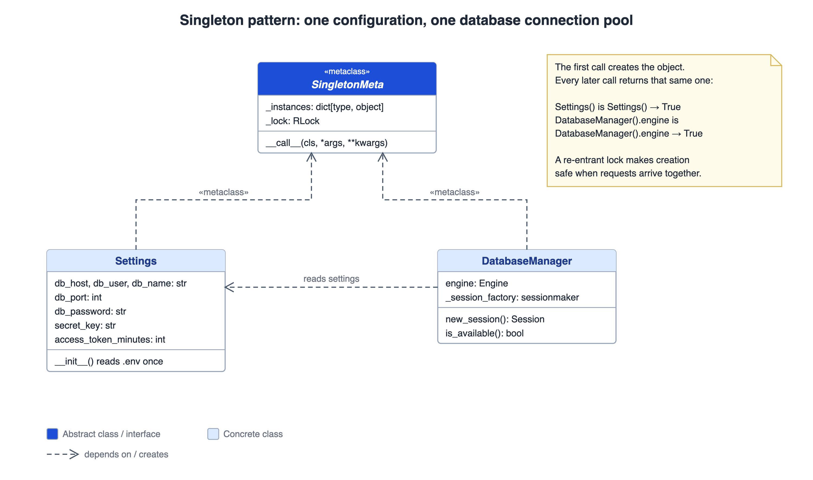
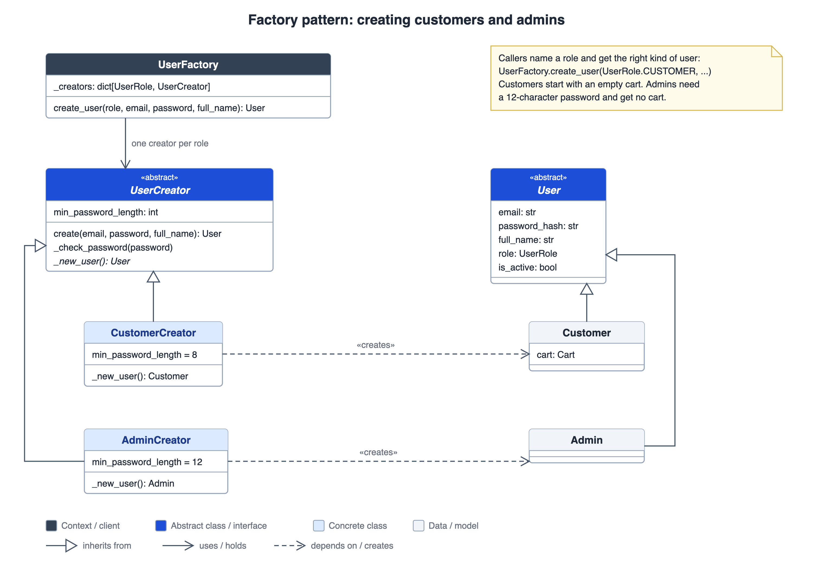
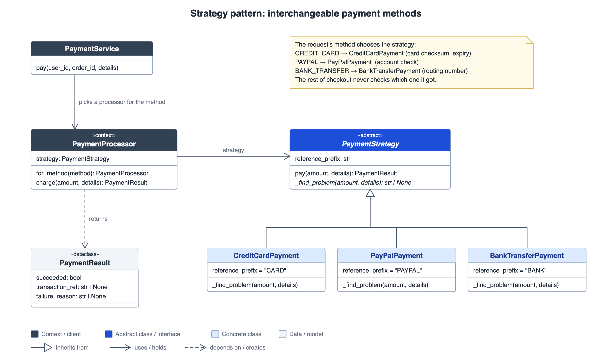
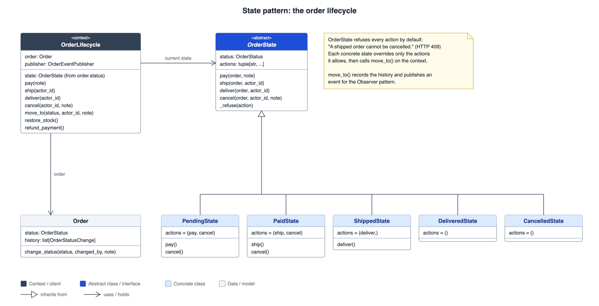
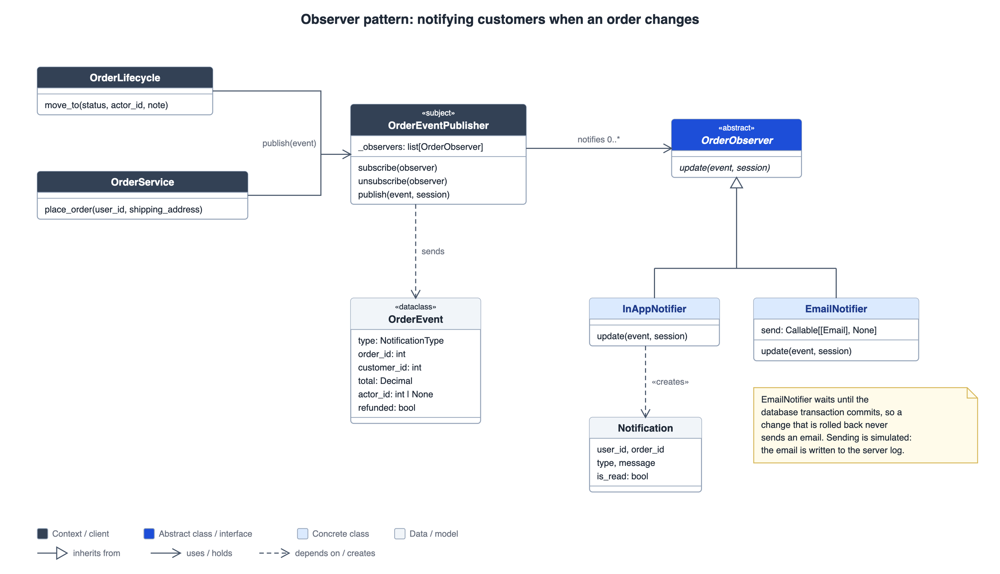
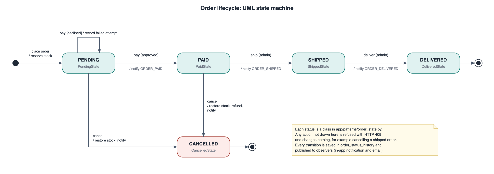
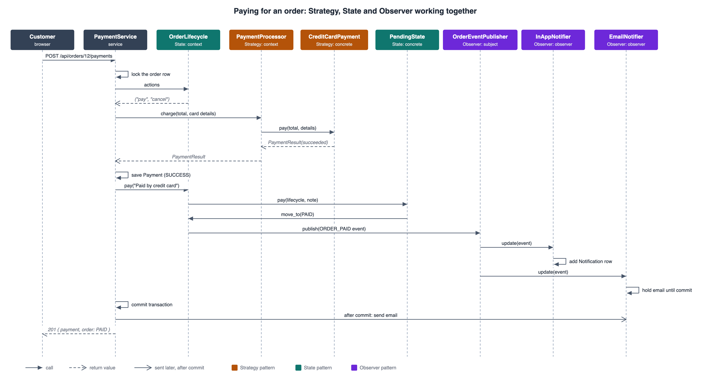

# Week 7: Observer Pattern and UML Diagrams

## 1. What was built

| Requirement | Result |
|---|---|
| FR-21 Notify on order events | When an order is placed, paid, shipped, delivered or cancelled, the customer gets an in-app notification and a simulated email. |
| FR-22 View and mark notifications | `GET /api/notifications` (with an unread count), `POST /api/notifications/{id}/read` and `POST /api/notifications/read-all`. |

**New page:** `/notifications.html`. Customers also see a **Notifications**
link in the header, with a badge showing how many are unread.

Emails are simulated as the requirements specify. Each one is written to the
server's terminal as a line starting with `EMAIL:`:

```text
EMAIL:    to=reader@example.com | Order #1 has shipped | Good news: order #1 is on its way.
```

## 2. Observer pattern

**Problem:** several things need to happen when an order changes: an in-app
notification, an email, and perhaps later a text message or a sales report.
If the order code called each of these directly, it would need to know about
all of them and would have to be edited every time one was added.

**Solution:** the order code only announces what happened. Anything interested
subscribes in advance and is told automatically. The code is in
[`app/patterns/order_observer.py`](../app/patterns/order_observer.py).

| Class | Role in the pattern |
|---|---|
| `OrderEventPublisher` | Subject: keeps the list of observers. `subscribe()`, `unsubscribe()`, `publish()` |
| `OrderObserver` | Observer interface: `update(event, session)` |
| `InAppNotifier`, `EmailNotifier` | Concrete observers |
| `OrderEvent` | The message passed to every observer |
| `OrderLifecycle.move_to()`, `OrderService.place_order()` | Where events are published |

**Points to explain in the demo:**

- **Where the patterns meet:** every status change already goes through
  `OrderLifecycle.move_to()` from the State pattern, so publishing there
  covers every change, with no risk of one being missed.
- **Timing:** the in-app notification is written in the same database
  transaction as the order change, so both are saved or neither is. Emails wait
  until that transaction commits, so a change that fails and rolls back never
  sends one. A failed email does not undo an order change that was already saved.
- **Nothing is sent when nothing changed:** a declined payment or a refused
  action, such as shipping an unpaid order, produces no notification and no email.
- **Adding a reaction:** a new observer, such as `SmsNotifier`, is one class plus
  one `subscribe()` call in `build_default_publisher()`. The order code is not touched.

## 3. UML diagrams

All seven diagrams are in [`docs/diagrams/`](diagrams/), each as an SVG for
sharp printing and a PNG for slides. Color shows each class's role, which is
explained in the legend at the bottom of each diagram.

| Diagram | Type | Shows |
|---|---|---|
| [Singleton](diagrams/uml_singleton.png) | Class | `SingletonMeta`, `Settings`, `DatabaseManager` |
| [Factory](diagrams/uml_factory.png) | Class | `UserFactory`, the creators, and the users they build |
| [Strategy](diagrams/uml_strategy.png) | Class | `PaymentProcessor` and the three payment strategies |
| [State](diagrams/uml_state_pattern.png) | Class | `OrderLifecycle` and the five state classes |
| [Observer](diagrams/uml_observer.png) | Class | `OrderEventPublisher` and the two notifiers |
| [Order lifecycle](diagrams/uml_order_states.png) | State machine | Every allowed status change and its effects |
| [Paying for an order](diagrams/uml_payment_sequence.png) | Sequence | Strategy, State and Observer working together in one request |

The brief requires UML for at least 2 patterns. These cover all five, plus a
state machine and a sequence diagram.

### Singleton



### Factory



### Strategy



### State



### Observer



### Order lifecycle (state machine)



### Paying for an order (sequence)

This is the best diagram to walk through in the demo, because one payment
request uses three patterns in turn:

1. **State:** before charging, the service asks the order's current state
   whether `pay` is allowed.
2. **Strategy:** `PaymentProcessor` hands the charge to `CreditCardPayment`.
3. **State:** `PendingState.pay()` moves the order to `PAID`.
4. **Observer:** `move_to()` publishes `ORDER_PAID`. The in-app notifier saves
   a notification, and the email notifier holds its email until the commit.



## 4. All five design patterns

| Pattern | Problem it solves here | Code | Built in |
|---|---|---|---|
| Factory | Customers and admins need different rules and defaults | `app/patterns/user_factory.py` | Week 3 |
| Singleton | One configuration and one connection pool for the whole app | `app/patterns/singleton.py`, `app/core/` | Week 3 |
| Strategy | Each payment method validates and charges differently | `app/patterns/payment_strategy.py` | Week 5 |
| State | What an order allows depends on its status | `app/patterns/order_state.py` | Week 6 |
| Observer | Several reactions to an order change, added without editing order code | `app/patterns/order_observer.py` | Week 7 |

## 5. Testing

| File | Covers |
|---|---|
| `test_order_observer.py` | Subscribing, unsubscribing, publish order, messages, emails only after commit |
| `test_notifications_api.py` | One notification per change, none for refusals, reading and marking, privacy |
| `test_order_state.py` | Now also checks that each allowed change publishes exactly one event |

## 6. Suggested demo

1. As a customer, place an order. The **Notifications** badge shows 1, and the
   server terminal prints an `EMAIL:` line.
2. Pay with the declined card, `4000 0000 0000 0002`. No new notification
   appears, because nothing changed.
3. Pay with PayPal. A payment notification and email follow.
4. As an admin, ship the order. The customer gets "order #N is on its way".
5. Open **Notifications**, mark one as read, then click **Mark all as read**.
6. Show the sequence diagram and trace the same steps through it.
